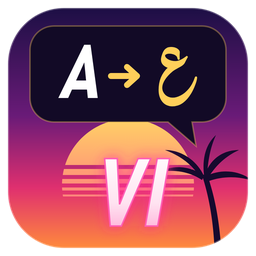

<p align="center">
  
</p>

<h1 align="center">VI Translator - iPhone and iPad</h1>

<p align="center">Live translations of your console game on your TV, with only an iPhone or iPad: no PC.</p>

---

## What it does

The phone reads the game from your console over the home network, and translates its subtitles and
objectives. Only the translated text goes to the TV, where a VI Translator TV app
([Android TV](https://github.com/vi-translator/vi-translator-android-tv), LG webOS, Samsung Tizen)
draws it over the game. The TV keeps showing the console's own HDMI picture at full quality.

The same app as the [Android phone app](https://github.com/vi-translator/vi-translator-android),
one universal app for iPhone and iPad (on an iPad, Setup's tabs are a side rail and Play has two
columns).

- **PlayStation 5:** PS Remote Play, through [chiaki-ng](https://github.com/streetpea/chiaki-ng).
  The stream is decoded by the phone's hardware decoder (VideoToolbox) into GPU memory, never
  shown, with no sound; about 4 frames a second are drawn by the GPU into plain RGBA and read.
- **Xbox:** Microsoft's own Remote Play web player (`play.xbox.com/remoteplay`) inside the app; its
  picture is copied about 4 times a second (or, if those copies come out black, the app records its
  own screen with ReplayKit, which iOS asks you to allow).
- **Reading:** Apple's Vision text recognition, on the phone.
- **Translating and the TVs:** VI Translator's shared core (the `vi-translator-core` Rust crate),
  which also serves the TV page on the home network, so the TV apps connect to the phone just as
  they do to the PC app and the Android app.

## Setup

1. **Console.**
   - *PS5:* turn on Remote Play on the PS5 (Settings › System › Remote Play). In the app, sign in to
     PSN **with a second account, not the one you play with** (Remote Play signs it in on the PS5;
     the app keeps only its account ID), find the PS5, and type the 8-digit PIN the PS5 shows under
     *Link Device*.
   - *Xbox:* turn on remote features on the Xbox. *Start translating* opens Microsoft's player; sign
     in there with your Microsoft account and connect to your console.
2. **TV:** open VI Translator on the TV: it shows a 6-digit code. In the app, *Connect a TV*, pick
   it, type the code, *Connect*.
3. **Game and language**, then **Start translating**.

**Keep the phone on VI Translator while playing.** iOS pauses apps that leave the screen, and the
PS5's stream with them (the Android app can keep going with the screen off; an iPhone can't). While
translating, the screen doesn't lock by itself; plug the phone in for a long session. If you leave
the app, translating starts again when you come back.

iOS asks once to let the app find devices on your local network (the PS5 and the TVs): allow it.

## Build

This repository builds on macOS with Xcode 16 or later. The two native libraries are built first,
into `Frameworks/` (not committed):

```sh
brew install xcodegen cmake ninja protobuf
rustup target add aarch64-apple-ios aarch64-apple-ios-sim
git submodule update --init          # chiaki-ng (native/build-chiaki.sh fetches its own submodules)
native/build-core.sh                 # the shared core → Frameworks/ViTranslatorCore.xcframework
native/build-chiaki.sh               # PS Remote Play → Frameworks/VitChiaki.xcframework
xcodegen generate                    # VITranslator.xcodeproj, from project.yml
open VITranslator.xcodeproj
```

CI (`.github/workflows/build.yml`, on GitHub's macOS runners) does the same on every push, runs the
unit tests in the Simulator, builds the app for iPhones (unsigned, as an artifact), and runs the app
in the Simulator as an iPhone and an iPad: screenshots of every screen, and an end-to-end check of
the TV side (a stand-in TV, `ci/fake_tv.py`, is connected with its code, the app reads a game-like
picture it draws itself, and the TV must get the lines on its page).

### The core

Reading and translating are VI Translator's shared core, the same code as the desktop app:
`vi-translator-ffi` in the [desktop app's repository](https://github.com/vi-translator/vi-translator-desktop)
(`core/`), at the commit named in `core.ref`. The app gives it whole frames (`processFrame`); the
core crops its areas, has Vision read them (`App/Core/VisionRecognizer.swift`, called
synchronously), translates, and serves the TV page. Its Swift bindings are in
`App/Core/Generated/` (generated by UniFFI); `native/build-core.sh` copies them with the library,
and CI checks the committed copy is the same.

The phone build has no offline translator: lines the translation memory knows (reviewed
translations, downloaded from vitranslator.app) are translated for free; for the others the user
picks a translation service (DeepL, Google, Claude, OpenAI...) with their own key.

### PS Remote Play

chiaki-ng's library (in `third-party/chiaki-ng`, a submodule pinned to a release, the same as the
Android app's) is built for iOS by `native/build-chiaki.sh`, with OpenSSL built for iOS. The app
calls it through a small C layer (`native/shim/vitchiaki.h`): a video-only session, the discovery
of the consoles, waking one, registering. The H.264 frames go to `App/PS/H264Decoder.swift`
(VideoToolbox); `App/PS/FrameConverter.swift` has Core Image draw each decoded buffer into RGBA on
the GPU and stretches the studio levels once more (16–235 to 0–255), as the Android app does: the
PS5's Remote Play picture needs it for GTA VI's pause menu to be recognised.

### In the Simulator

Launch arguments (for trying screens and for CI): `-vitMode play|setup`, `-vitTab source|show|…`,
`-vitConsole ps5|xbox`, `-vitUiLang ar`, `-vitPs5Steps YES` (the PS5's linking steps even when one
is linked), `-vitDemoText "…"` (reads a picture the app draws with that subtitle),
`-vitPairTv <address> -vitPairCode <code>` (connects a TV at start).

## Testing on an iPhone or iPad

See [docs/device-test-plan.md](docs/device-test-plan.md). Installing on a device needs the app
signed: with a free Apple ID, Xcode can install it on your own device for 7 days; TestFlight and
the App Store need the Apple Developer Program (99 USD a year): see
[docs/app-store.md](docs/app-store.md) for the account, the API key and the TestFlight workflow.

## License

[GNU AGPL v3](LICENSE), as it includes chiaki-ng (AGPL-3.0, with an OpenSSL exception); chiaki-ng's
own files keep their license notices. PlayStation, PS5 and PS Remote Play are trademarks of Sony
Interactive Entertainment; Xbox is a trademark of Microsoft. This app isn't made or endorsed by
either.
